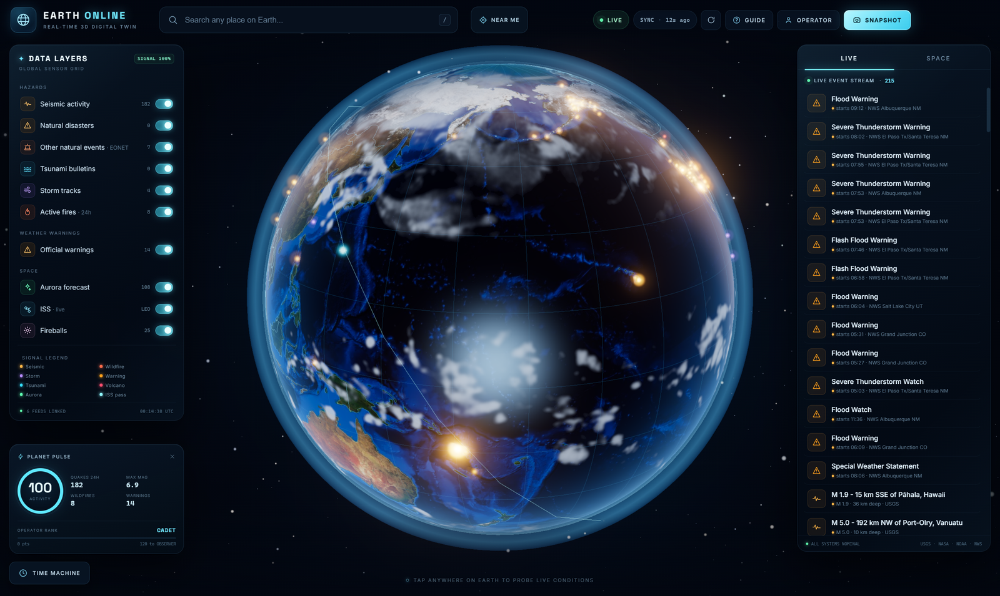

# Earth Online · 实况地球

> 一个真正可运行的 3D 地球数字孪生桌面应用：地震、野火、风暴、极光、国际空间站与实时天气，全部叠加在一颗可交互的地球上。
>
> A real, playable 3D digital twin of Earth — live earthquakes, wildfires, storms, aurora, the ISS and local weather on an interactive WebGL globe.


**中文** | [English](#english)



---

## 这是什么

Earth Online 是一个 Electron + Three.js 桌面应用。它不是静态演示：启动后会从多家公开机构实时拉取数据，并绘制在带有昼夜、云层、大气辉光和星空的地球上。

- **桌面原生窗口**：Electron 打包，双击 EXE 即可运行
- **真实数据**：USGS、NASA、NOAA、NWS、CNEOS、WhereTheISS、Open-Meteo
- **完全本地化资源**：贴图、字体、国界、Three.js 全部内置，不依赖 CDN
- **断网可用**：优先显示上次缓存；没有缓存时回退到合成演示数据
- **无 API Key、无账号、无遥测**

## 功能

### 3D 地球

- 昼夜混合 shader：白天贴图 + 夜间城市灯光，按真实太阳直射点过渡
- 独立云层球壳、菲涅尔大气辉光、Bloom 后处理、星空背景
- 国界线、经纬网、实时晨昏线
- 鼠标拖拽旋转、滚轮缩放、射线拾取点击探测

### 可切换图层

- 地震（USGS，近 24 小时）
- 自然灾难（火山、洪水等）
- 其他自然事件（干旱、沙尘、海冰等，EONET）
- 海啸公告
- 风暴路径
- 24 小时活跃野火
- 官方气象预警（NWS）
- 极光预报（NOAA SWPC）
- 国际空间站实时位置与轨道
- 火流星（NASA CNEOS）

### 交互与游戏化

- 右侧实时事件流：按优先级排序，点击条目飞向事件并展开详情
- 搜索任意地点：自动飞行到目标并读取当地实时天气
- 点击地球任意位置：当地时间、气温、风速、湿度、气压、日出日落、附近灾害
- 时间机器：回看最近 30 天的 USGS 地震与 NASA EONET 事件
- 操作员系统：积分、等级、成就、探测记录、路径点，保存在本机
- 一键导出当前地球画面为 PNG
- 快捷键：`/` 搜索、`T` 时间机器、`R` 刷新、`G` 指南、`Esc` 关闭弹窗

## 实时数据源

| 数据 | 来源 | 说明 |
|---|---|---|
| 地震 | [USGS Earthquake Hazards](https://earthquake.usgs.gov/earthquakes/feed/v1.0/summary/all_day.geojson) | 近 24 小时全球地震 |
| 自然事件 / 野火 / 风暴 / 火山 | [NASA EONET v3](https://eonet.gsfc.nasa.gov/api/v3/events) | 开放事件 |
| 气象预警 | [NWS Alerts API](https://api.weather.gov/alerts/active) | 美国境内 |
| 极光 | [NOAA SWPC OVATION](https://services.swpc.noaa.gov/json/ovation_aurora_latest.json) | 极光卵形带 |
| 火流星 | [NASA CNEOS Fireball API](https://ssd-api.jpl.nasa.gov/fireball.api) | 近期火流星 |
| 国际空间站 | [WhereTheISS.at](https://api.wheretheiss.at/v1/satellites/25544) | 实时位置 + 轨道 |
| 天气 / 当地时间 | [Open-Meteo](https://open-meteo.com/) | 按需查询 |
| 地点反查 | [BigDataCloud](https://www.bigdatacloud.com/) | 按需查询 |
| IP 定位 | [ipwho.is](https://ipwho.is/) | “NEAR ME” |

应用启动时并发拉取，之后每 70 秒刷新一次。所有请求在 Electron 主进程完成，渲染进程通过 IPC 获取结果，避免 CORS 与密钥暴露。

## 下载与运行

前往 [Releases](https://github.com/super964/earth-online-desktop/releases/latest) 下载：

```
Earth-Online-1.0.0-win64.zip
```

1. 解压 ZIP（不要只把 EXE 单独拖出来，`resources/` 必须与 EXE 放在一起）
2. 双击 `Earth Online.exe`
3. 首次启动需要联网，通常 3～10 秒完成数据加载

> 应用未做代码签名。Windows 若提示“已保护你的电脑”，点击 **更多信息 → 仍要运行**。

### 系统要求

- Windows 10 / 11 64 位
- 支持 WebGL2 的显卡（集成显卡亦可）
- 建议 8 GB 内存

## 从源码运行

需要 Node.js 20+。

```bash
git clone https://github.com/super964/earth-online-desktop.git
cd earth-online-desktop
npm install
npm start
```

### 打包 Windows 便携版

```bash
npm run package
# 输出：dist/Earth Online-win32-x64/
```

打包脚本会优先复用本机 Electron 缓存；如果找不到缓存，再让 `electron-packager` 下载。

## 项目结构

```text
earth-online-desktop/
├─ main.js                 # Electron 主进程：数据抓取、缓存、IPC、窗口
├─ preload.js              # contextBridge 暴露 window.earth
├─ scripts/package.mjs     # 便携版打包脚本（自动查找 Electron 缓存）
├─ src/
│  ├─ index.html           # 界面结构 + SVG 图标
│  ├─ styles.css           # 深色 HUD 视觉
│  ├─ js/
│  │  ├─ app.js            # 数据、交互、时间机器、成就系统
│  │  └─ globe.js          # Three.js 地球、shader、图层、标注
│  ├─ assets/
│  │  ├─ textures/         # 地球昼夜、云层、法线、高光、地形
│  │  ├─ fonts/            # Inter / Space Grotesk
│  │  └─ data/             # 110m 国界 TopoJSON
│  └─ vendor/              # Three.js 与 TopoJSON（本地引入）
├─ assets/icon.ico
├─ docs/screenshot.png
├─ README.txt              # 随便携版分发的说明
└─ THIRD_PARTY.md
```

## 已知限制

- 气象预警只覆盖美国（NWS 的数据范围）。
- 时间机器只回放 USGS 地震与 EONET 事件，不包含当时的预警、极光和 ISS。
- 历史查询依赖上游 API 的数据保留范围，未必能回到完整 30 天。
- 便携版目前只针对 Windows x64 打包。
- 界面为英文；代码注释与 README 提供中文说明。

## 隐私

- 应用不收集、不上传任何个人数据。
- 所有网络请求只发往上述公开数据提供方。
- 游戏进度保存在本机 `localStorage`，数据缓存在 Electron 的 `userData` 目录。
- 删除 `%APPDATA%\Earth Online` 即可清空缓存与进度。

## 许可证

MIT © 2026 super964

本项目是受 [earth-live.app](https://earth-live.app/) 启发的独立作品，与 earth-live.app 及任何数据提供机构无隶属关系。数据版权归各来源机构所有。第三方资源许可见 [THIRD_PARTY.md](THIRD_PARTY.md)。

---

<a id="english"></a>
# Earth Online — English

A real, playable 3D digital twin of Earth, built with Electron and Three.js.


## What it is

Earth Online is a Windows desktop app that turns live public data into an interactive globe. It is not a mockup: on launch it fetches current earthquakes, wildfires, storms, weather alerts, aurora, fireballs and the ISS position from public agencies, then renders them on a day/night Earth with clouds, atmosphere and a starfield.

All textures, fonts, borders and Three.js modules are bundled locally. No API keys, no accounts, no telemetry.

## Features

- **Day/night globe** — custom shader blending day imagery and city lights by the real subsolar point; cloud shell, Fresnel atmosphere, bloom, starfield
- **Ten toggleable layers** — earthquakes, natural disasters, other EONET events, tsunami bulletins, storm tracks, wildfires, NWS warnings, aurora, ISS, fireballs
- **Live event stream** — priority-sorted; click an item to fly there and open details
- **Search & probe** — geocode any place, or click anywhere on the globe for local weather, time, sun elevation and nearby hazards
- **Time machine** — replay the last 30 days of USGS earthquakes and NASA EONET events
- **Operator progression** — points, ranks, achievements, probes and waypoints persisted locally
- **Snapshot export** — save the current globe as PNG
- **Offline-friendly** — disk cache first, then synthetic demo telemetry

## Quick start

Download the latest ZIP from [Releases](https://github.com/super964/earth-online-desktop/releases/latest), extract it, and run `Earth Online.exe`.

From source:

```bash
git clone https://github.com/super964/earth-online-desktop.git
cd earth-online-desktop
npm install
npm start
```

Build the portable Windows folder:

```bash
npm run package
# -> dist/Earth Online-win32-x64/
```

## Data sources

USGS · NASA EONET · NOAA/NWS · NOAA SWPC · NASA CNEOS · WhereTheISS.at · Open-Meteo · BigDataCloud · ipwho.is

Feeds are fetched in the Electron main process and cached under the app's `userData` directory. The renderer talks to it through a narrow `contextBridge` API.

## License

MIT © 2026 super964

Independent project inspired by [earth-live.app](https://earth-live.app/); not affiliated with it or with any data provider. Data copyright belongs to the respective agencies. See [THIRD_PARTY.md](THIRD_PARTY.md) for bundled asset licenses.
